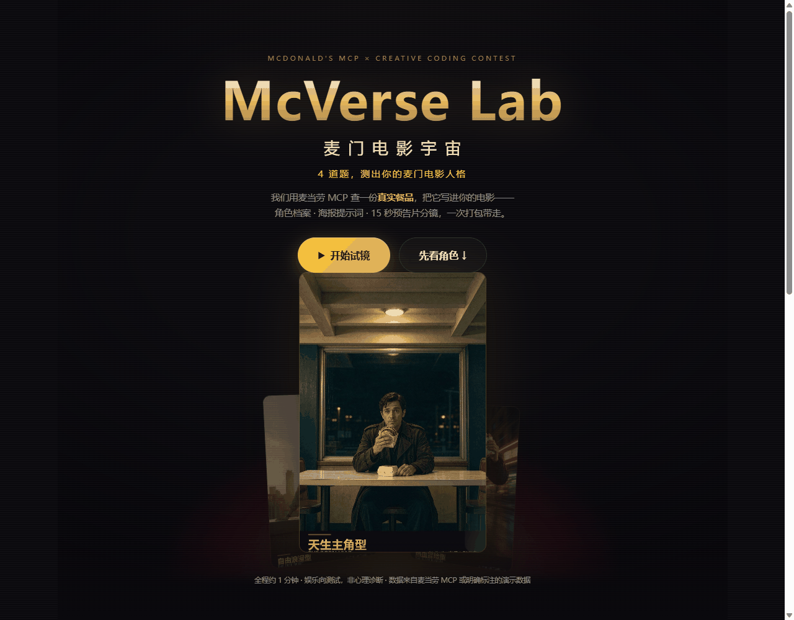
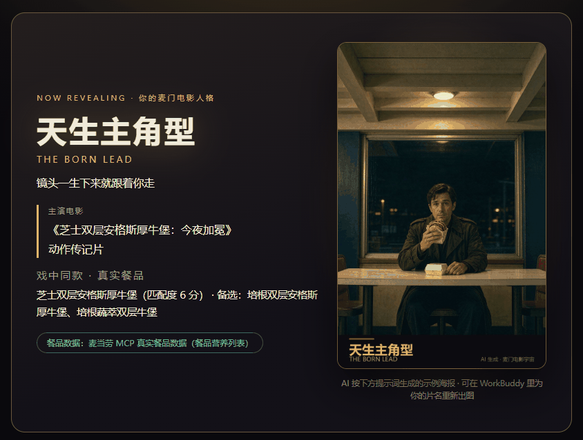
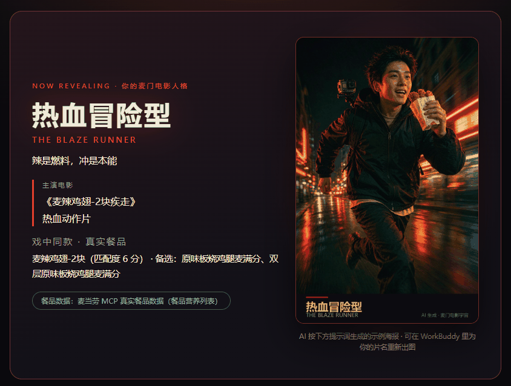
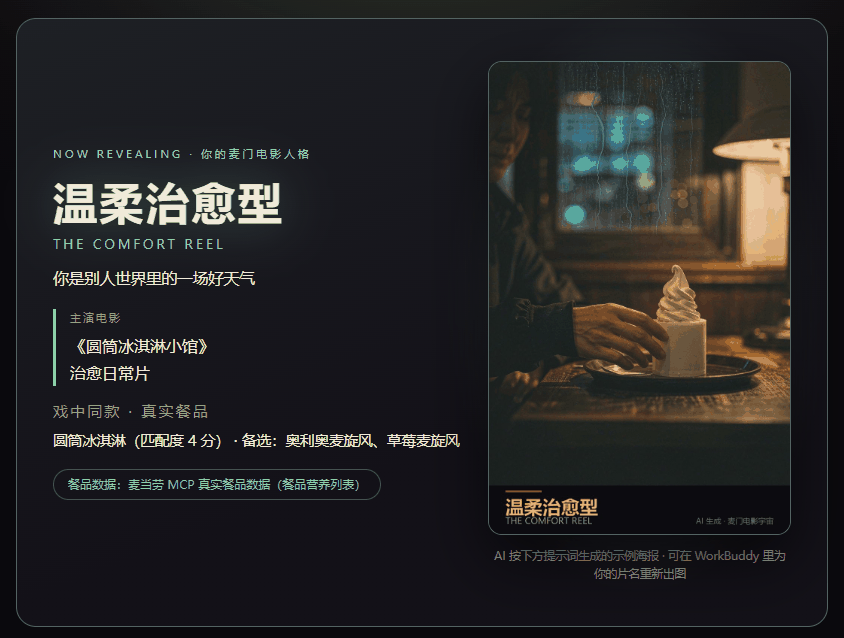
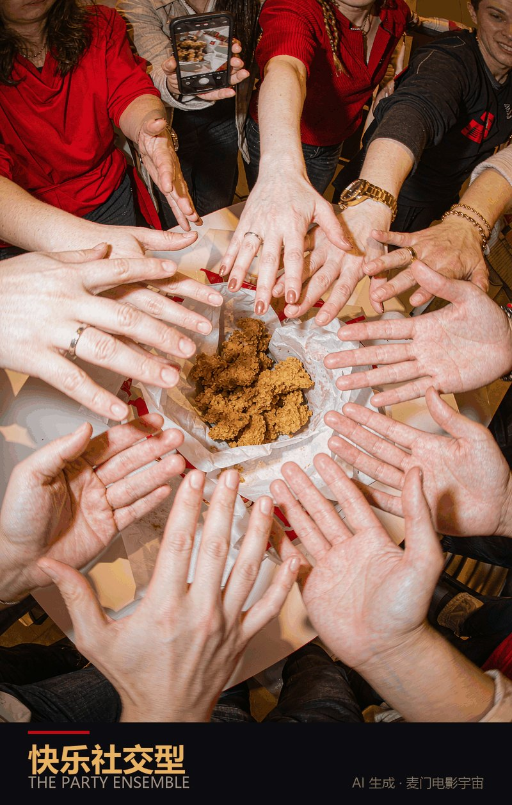
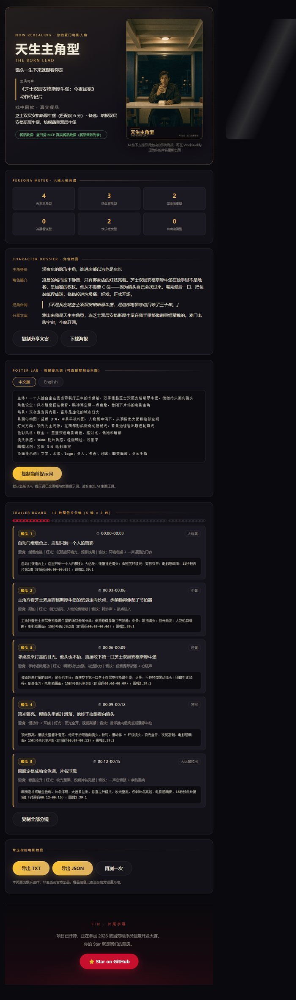
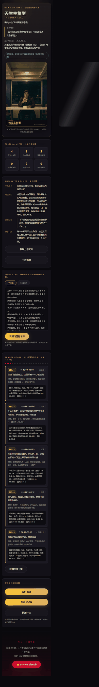

# 🍔 McVerse Lab · 麦门电影宇宙


> 回答 4 道题，测出你的**麦门电影人格**。系统通过麦当劳 MCP 查一份**真实餐品**，
> 把它写进你的专属电影——角色档案、中英双语海报提示词、15 秒预告片分镜，一次打包带走。



基于 [麦当劳中国官方 MCP 服务](https://github.com/M-China/mcd-mcp-server) 开发的参赛 Skill
—— **2026 麦当劳程序员创意开发大赛**（[官方活动仓库](https://github.com/M-China/mcd-developer-innovation-challenge)）。
推荐使用 [WorkBuddy](https://www.workbuddy.cn/) 开发与运行。

**本作品为娱乐创作，非麦当劳官方产品，不构成官方背书。**

---

## 👀 三种人格长什么样（餐品来自麦当劳 MCP 餐品营养列表）

<table>
<tr>
<td width="33%" align="center"><br /><b>天生主角型</b><br /><sub>匹配：芝士双层安格斯厚牛堡<br />《芝士双层安格斯厚牛堡：今夜加冕》</sub></td>
<td width="33%" align="center"><br /><b>热血冒险型</b><br /><sub>匹配：麦辣鸡翅-2块<br />《麦辣鸡翅-2块疾走》</sub></td>
<td width="33%" align="center"><br /><b>温柔治愈型</b><br /><sub>匹配：圆筒冰淇淋<br />《圆筒冰淇淋小馆》</sub></td>
</tr>
</table>

### 🎬 不是只给提示词 —— 可以直接出海报

配套的 WorkBuddy Skill 会把上面的提示词**直接交给生图能力，产出真海报**。下面是六个人格的示例海报（全部由本项目提示词 + WorkBuddy 生图产出）：

<table>
<tr>
<td width="16%" align="center"><br /><sub>天生主角型</sub></td>
<td width="16%" align="center"><br /><sub>热血冒险型</sub></td>
<td width="16%" align="center"><br /><sub>温柔治愈型</sub></td>
<td width="16%" align="center"><br /><sub>冷静智谋型</sub></td>
<td width="16%" align="center"><br /><sub>快乐社交型</sub></td>
<td width="16%" align="center"><br /><sub>自由浪漫型</sub></td>
</tr>
</table>

### 📄 一份完整电影档案（含海报、档案、提示词、分镜）



<sub>人格卡 · AI 海报 · 电影档案 · 海报提示词（中英双语）· 5 镜分镜 · 一键导出 —— 一屏跑完全流程。</sub>

### 📱 手机端同样能打



---

## ✨ 它能做什么

| 你说 / 你做 | 它给你 |
|---|---|
| 回答 4 道趣味人格题 | 6 种麦门电影人格之一（确定性评分，同输入必同结果） |
| 自动查询麦当劳 MCP | 与人格匹配的**麦当劳 MCP 真实餐品数据**（餐品营养列表；仅在提供定位且门店菜单查询成功时才用「当前门店菜单」）；MCP 不可用时明确标注 DEMO 模式 |
| 一键生成 | 电影片名 / 类型 / 主角身份 / 角色简介 / 经典台词 / 分享文案 |
| 生成海报提示词 | 中英双语，竖版 3:4，含画幅与负面提示词，可直接粘贴进生图工具 |
| **直接把海报画出来** | 配套 Skill 可调用 WorkBuddy 生图能力，把提示词变成**真海报图**（每张约 5-10 积分，需你确认） |
| 生成预告片分镜 | 5 镜 × 3 秒 = 15 秒，时间码精确，每镜含 AI 视频提示词 |

六种人格：**天生主角型 / 热血冒险型 / 温柔治愈型 / 冷静智谋型 / 快乐社交型 / 自由浪漫型**

## 🚀 快速开始

```bash
git clone https://github.com/kaoing2012-art/mcverse-lab.git
cd mcverse-lab
```

### 1. 申请麦当劳 MCP Token（免费）

前往 [open.mcd.cn/mcp](https://open.mcd.cn/mcp) → 手机号登录 → 右上角「控制台」→「激活」→ 复制 Token。

### 2. 配置 Token（只支持以下两种方式）

> ⚠️ **本项目不会读取 `.env` 文件**（没有引入 dotenv，也没有任何 dotenv 依赖）。
> `.env.example` 仅用于说明可用的环境变量名，**"复制成 `.env` 就生效"是不成立的**。

```bash
# 方式 A：环境变量（推荐）
#   Windows PowerShell : $env:MCD_MCP_TOKEN="你的Token"
#   Windows CMD        : set MCD_MCP_TOKEN=你的Token
#   macOS / Linux      : export MCD_MCP_TOKEN=你的Token
export MCD_MCP_TOKEN=你的Token

# 方式 B：写入本地文件（内容只放 Token 本身，不要加引号或前缀）
mkdir -p ~/.config/mcd && echo "你的Token" > ~/.config/mcd/mcp_token
```

> 没配 Token 也能跑——项目会进入 **DEMO 模式**，并在结果里明确标注「非实时数据」。

### 3. 启动 Web Demo

```bash
npm start          # 即 node src/server.js
# 打开 http://localhost:3000
```

### 4. 或使用命令行

```bash
node src/cli.js --answers 1,0,3,2              # A/B/C/D 对应 0/1/2/3
node src/cli.js --answers 1,0,3,2 --location 上海市黄浦区   # 可选：尝试查询当前门店菜单（失败则回退营养列表）
```

### 5. 在 WorkBuddy 中使用（Skill）

把 `skills/mcverse/` 复制到 `~/.workbuddy/skills/`（用户级）或项目 `.workbuddy/skills/`，
然后在对话里说：

```
帮我做麦门电影人格测试
```

Skill 会按 `skills/mcverse/SKILL.md` 的流程出题、调用 MCP、生成完整电影档案。

### 6. 配置 MCP 连接器（WorkBuddy / Cursor / Cherry Studio 等）

`mcp-config.example.json` 是一份**可直接被 `JSON.parse` 解析的纯 JSON**（不含任何注释——
JSON 标准不允许注释，所以本文件把所有说明都放在这里）：

| 字段 | 说明 |
|---|---|
| `mcpServers.mcd-mcp.type` | 固定为 `streamablehttp`（麦当劳 MCP 使用 Streamable HTTP 传输） |
| `mcpServers.mcd-mcp.url` | 官方端点 `https://mcp.mcd.cn` |
| `mcpServers.mcd-mcp.headers.Authorization` | `Bearer <你的 MCP Token>`，**必须替换 `YOUR_MCP_TOKEN`** |

使用方法：把该文件内容复制出来，替换 `YOUR_MCP_TOKEN` 后粘贴到
WorkBuddy【专家·技能·连接器】→【连接器】→【自定义连接器】→【配置MCP】，保存并启用。
其它客户端（Cursor / Cherry Studio / Trae / VSCode）配置格式一致。

## 🏃 运行测试

```bash
npm test          # 24 个测试：评分确定性、256 组合全遍历、匹配稳定性、
                  # 写操作拦截、Token 脱敏、Demo 降级、分镜时间码等
```

## 📁 项目结构

```
mcverse-lab/
├── README.md                    # 本文件
├── LICENSE                      # MIT + 第三方商标声明
├── CONTEST_DECLARATION.md       # 参赛声明（官方文件，内容未改动）
├── MCP_INTEGRATION.md           # MCP 接入与调用流程说明
├── mcp-config.example.json      # MCP 连接器配置示例
├── workbuddy.md                 # WorkBuddy 联动开发记录
├── skills/mcverse/SKILL.md      # WorkBuddy Skill 定义
├── src/
│   ├── persona.js               # 题库 + 确定性评分 + 平分规则
│   ├── mcp-client.js            # 零依赖 MCP 客户端（Streamable HTTP）
│   ├── matching.js              # 人格×餐品匹配 + MCP 响应归一化
│   ├── generator.js             # 电影档案 / 海报提示词 / 分镜生成
│   ├── pipeline.js              # 主流水线（含 Demo 降级）
│   ├── server.js                # 本地演示服务器（Token 不进浏览器）
│   ├── cli.js                   # 命令行入口
│   └── data/demo-menu.json      # Demo 模式数据（明确标注非实时）
├── public/                      # HTML Demo（暗色电影主题，移动端优先）
├── scripts/
│   ├── security-scan.mjs        # 凭证泄露自检（提交前必跑）
│   └── publish-to-github.mjs    # 一键发布到 GitHub（创建仓库 + 推送）
├── tests/                       # node:test 单元测试 + 真实 MCP 验证脚本
├── docs/CONTEST_SUBMISSION.md   # 参赛提交清单与报名 Issue 文案
└── examples/                    # 示例输出（live 真实数据 + demo）
```

## 🔒 提交前安全自检

```bash
node scripts/security-scan.mjs
# 扫描全部文件，与本地真实 Token 精确比对 + 常见凭证格式匹配
# 退出码 0 = 干净，可直接发布
```

## 🧠 技术要点

- **零依赖**：Node.js 18+ 原生能力实现全部功能（含 MCP Streamable HTTP 客户端）
- **确定性**：评分、平分规则、匹配、文案生成全部纯函数，同输入必同输出
- **安全**：
  - **只读白名单（默认拒绝）**：仅允许 `now-time-info` / `list-nutrition-foods` /
    `query-nearby-stores` / `query-meals` / `query-meal-detail` 五个查询类工具，
    名单之外的任何工具（含未来新增工具）代码层直接拒绝
  - Token 只存在于服务端进程（环境变量 / 本地文件），浏览器不可见
  - 日志与错误信息统一脱敏（`Bearer ***`）
- **数据来源分级**：`live_store`（门店菜单）/ `live_catalog`（餐品营养列表）/ `demo`（演示数据），
  三者在 UI 与导出文本中都如实标注，不夸大来源
- **诚实降级**：MCP 失败自动进入 DEMO 模式，结果页显著标注，绝不把演示数据说成实时数据
- **工具发现**：先 `tools/list` 再调用，不假定任何工具名一定存在

## 🎯 目标用户

- 麦门信徒：想把对麦当劳的爱玩出花的那群人
- AI 创作爱好者：需要现成的海报提示词与分镜脚本
- 朋友聚会组织者：人格测试永远是破冰神器

## ⚠️ 声明

- 本项目为麦当劳程序员节创意开发大赛参赛作品，由参赛者独立开发，非麦当劳官方产品
- 人格测试仅用于娱乐，不构成任何科学心理诊断
- 餐品信息、价格及供应状态以麦当劳官方渠道的实时结果为准
- 本仓库不包含任何真实 Token；McDonald's 相关商标归权利人所有

## 🏆 参赛信息

- 项目仓库：<https://github.com/kaoing2012-art/mcverse-lab>
- 赛事：[2026 麦当劳程序员创意开发大赛](https://github.com/M-China/mcd-developer-innovation-challenge)
- 开发工具：[WorkBuddy](https://www.workbuddy.cn/)

如果这个项目给你带来了快乐，欢迎点个 ⭐ Star 支持一下！
